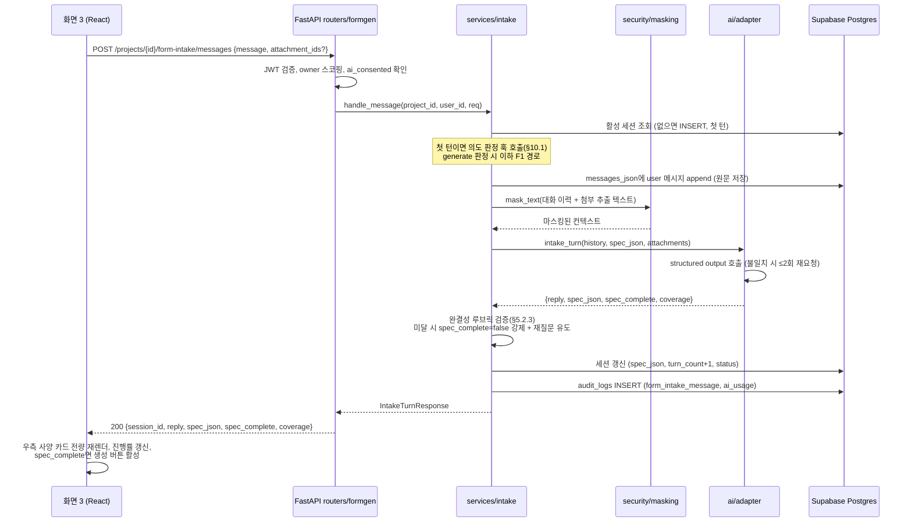
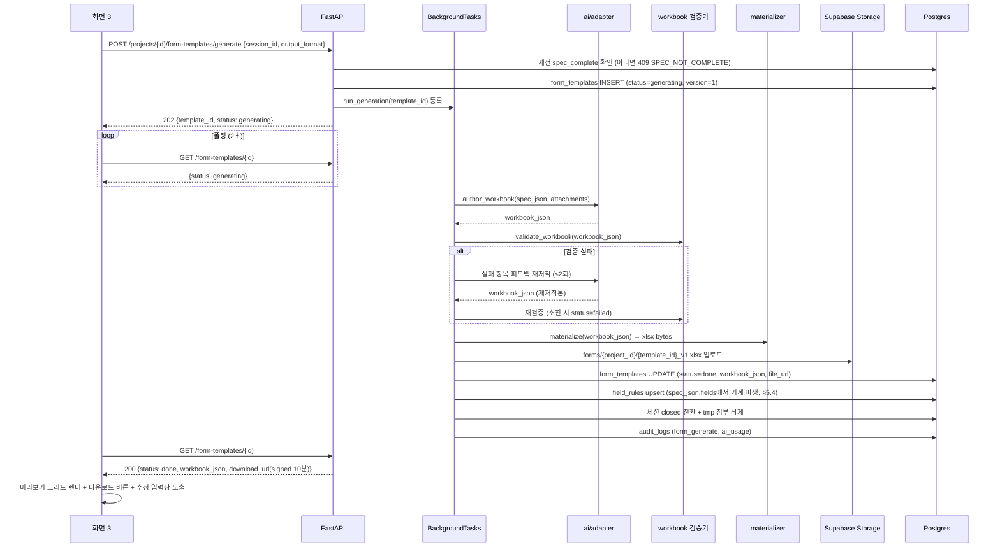

# 상세명세: 생성 기능 (F1. AI 양식 생성)

| 항목 | 내용 |
|---|---|
| 문서 버전 | v1.0 |
| 작성일 | 2026-07-22 |
| 기준 문서 | 취합앱_PRD_v1.6.md (F1, F6 접점, §6.2/§6.4/§6.5), 생성기능_기술명세_v0.1.md (문서 버전 v0.3 — 결정 D1~D4, 판단 J1~J5 전부 승계), design.md v1.0, 인지기능_기술명세_v0.1.md (접점 인터페이스 참조) |
| 범위 | F1-1 ~ F1-7의 **구현 착수 가능 수준** 상세: LLM 프롬프트 전문, structured output JSON Schema 전문, Pydantic 모델, DB DDL, 검증기 알고리즘, materializer 변환 매핑, 에러 코드 체계, 시퀀스, 프론트엔드 컴포넌트·훅 설계. F6은 접점 인터페이스만 정의(§10)하고 내부 상세는 인지기능_기술명세_v0.1.md에 위임 |
| 상태 | 초안 |
| 변경 이력 | v1.0 — 최초 작성. 기술명세 v0.3을 구현 레벨로 고도화(신규 결정 없음, 기존 결정의 구체화만 수행). 작성 시 정한 세부값 6건 사용자 확인 완료(2026-07-22): temperature(intake 0.3/저작 0.2)·generate 상한(180s/120s)·rate limit(분당 20턴)·field_rules delete-insert·closed 세션 새 세션 자동 생성은 원안 유지, **대화 이력은 절단(20개) 대신 전체 전달로 변경**(§5.2.2, §6.4) |

> **문서 관계**: 생성기능_기술명세_v0.1.md(v0.3)는 "무엇을·왜"의 결정 기록으로 보존하고, 본 문서는 "어떻게"의 구현 명세를 담는다. 두 문서가 충돌하면 기술명세의 결정(D1~D4, J1~J5)이 우선하며 본 문서를 수정한다.

---

## 목차

1. [전체 시퀀스](#1-전체-시퀀스)
2. [에러 코드 체계](#2-에러-코드-체계)
3. [DB DDL](#3-db-ddl)
4. [백엔드 — Pydantic 모델](#4-백엔드--pydantic-모델)
5. [백엔드 — 서비스 모듈 상세](#5-백엔드--서비스-모듈-상세)
6. [AI 연동 — 어댑터 구현 상세](#6-ai-연동--어댑터-구현-상세)
7. [AI 연동 — 프롬프트·스키마 전문](#7-ai-연동--프롬프트스키마-전문)
8. [Materializer 변환 매핑](#8-materializer-변환-매핑)
9. [프론트엔드 상세](#9-프론트엔드-상세)
10. [F6 접점 인터페이스](#10-f6-접점-인터페이스)
11. [구현 체크리스트](#11-구현-체크리스트)

---

## 1. 전체 시퀀스

### 1.1 문답 1턴 (INTAKE)



### 1.2 생성 (GENERATE) + 폴링



### 1.3 대화형 수정 (REVISE, F1-7)

generate와 동일 골격이되 다음이 다르다.

- 어댑터 호출이 `revise_workbook(현재 workbook_json, spec_json, instruction)`으로 대체되고, **workbook_json·spec_json 전체 갱신본**을 받는다.
- 성공 시 `version+1`, Storage에는 새 버전 경로로 저장(이전 버전 파일 보존 — J5), field_rules 전체 재파생.
- **실패 시 롤백(J1)**: `status`를 `failed`로 두지 않고 **직전 done 상태로 되돌린다** — DB 트랜잭션에서 version·workbook_json·file_url을 갱신 전 값으로 유지하고, 응답 폴링에는 `{status: "done", revise_error: {...}}`를 1회 포함시켜 프론트가 오류 토스트만 표시하게 한다(§4.6 `ReviseErrorInfo`).

### 1.4 AI 장애 (PRD §6.4)

```
어댑터 호출 ──타임아웃 30s──▶ 1회 재시도(지수 백오프 2s→4s) ──실패──▶
  ├─ intake 턴: 503 AI_UNAVAILABLE → 프론트 시스템 버블 + 입력 보존(이력은 DB에 있으므로 재전송으로 이어감)
  ├─ generate: form_templates.status=failed + error_message → 프론트 재시도 버튼
  └─ revise: 직전 done 롤백(§1.3) + revise_error
서버 헬스: OpenAI 5xx 5분 내 5회 누적 시 GET /health/ai → {degraded: true} → 화면 2 배너
```

---

## 2. 에러 코드 체계

공통 실패 응답 포맷 (모든 4xx/5xx):

```jsonc
{ "error": { "code": "SPEC_NOT_COMPLETE", "message": "아직 확인되지 않은 사양이 있어 양식을 생성할 수 없습니다." } }
```

- `code`: 기계 판독용 UPPER_SNAKE. 프론트 분기 기준(문자열 메시지로 분기 금지).
- `message`: 사용자 표시 가능한 한국어 문구. 프론트는 그대로 토스트/인라인에 노출해도 된다.

| HTTP | code | 발생 조건 | 프론트 처리 |
|---|---|---|---|
| 401 | `UNAUTHORIZED` | JWT 누락/만료 | 로그인 화면 이동 |
| 403 | `AI_CONSENT_REQUIRED` | `profiles.ai_consent_at IS NULL`인 사용자의 F1 API 호출 | 동의 모달(§9.6) 표시 후 재시도 |
| 403 | `FORBIDDEN` | 타인 프로젝트/템플릿 접근 | 홈으로 이동 + 토스트 |
| 404 | `PROJECT_NOT_FOUND` / `SESSION_NOT_FOUND` / `TEMPLATE_NOT_FOUND` / `ATTACHMENT_NOT_FOUND` | 대상 리소스 없음(소프트 삭제 포함) | 토스트 후 목록/홈 이동 |
| 400 | `UNSUPPORTED_FILE_TYPE` | 첨부 확장자가 xlsx/hwpx/png 외, 또는 매직바이트 불일치 | 첨부 영역 인라인 오류 |
| 413 | `FILE_TOO_LARGE` | 첨부 50MB 초과 | 인라인 오류 |
| 400 | `ATTACHMENT_LIMIT_EXCEEDED` | 세션당 첨부 5개 초과 | 인라인 오류 |
| 400 | `INVALID_OUTPUT_FORMAT` | `output_format`이 `xlsx` 외 (hwpx는 예약만, D2) | 발생하면 프론트 버그 — 토스트 |
| 409 | `SPEC_NOT_COMPLETE` | 세션이 spec_complete 아닌 상태에서 generate | 생성 버튼 비활성이므로 정상 흐름에선 미발생. 발생 시 세션 재조회 |
| 409 | `SESSION_CLOSED` | closed 세션에 메시지/generate 요청 | 세션 재조회 후 새 문답 안내 |
| 409 | `GENERATION_IN_PROGRESS` | 동일 템플릿에 generate/revise 중복 요청 | 폴링 유지 |
| 422 | `VALIDATION_ERROR` | FastAPI/Pydantic 요청 검증 실패 (기본 핸들러를 공통 포맷으로 래핑) | 개발 단계 외 미발생 전제 |
| 429 | `RATE_LIMITED` | 사용자별 rate limit(문답 분당 20턴) 초과 | "잠시 후 다시 시도" 토스트 |
| 503 | `AI_UNAVAILABLE` | 어댑터 재시도 소진 (intake 턴 동기 경로) | 시스템 버블 + 재전송 유도 |
| 500 | `INTERNAL_ERROR` | 그 외 미분류 예외 | 공통 오류 토스트 |

비동기 경로(generate/revise)의 실패는 HTTP 에러가 아니라 `GET /form-templates/{id}` 응답의 `status=failed` + `error_message`(generate) 또는 `revise_error`(revise)로 전달한다.

`error_message` 표준 문구(LLM 원문 오류를 그대로 노출하지 않는다):

| 내부 원인 | error_message |
|---|---|
| structured output 스키마 불일치 재시도 소진 | "AI가 양식 구조를 완성하지 못했습니다. 다시 시도해주세요." |
| workbook 검증 실패 재저작 소진 | "생성된 양식이 안전 기준을 통과하지 못했습니다. 사양을 조금 바꿔 다시 시도해주세요." |
| OpenAI 타임아웃/5xx | "AI 서비스가 일시적으로 불안정합니다. 잠시 후 다시 시도해주세요." |
| 변환(materializer)/Storage 오류 | "파일 생성 중 오류가 발생했습니다. 다시 시도해주세요." |

---

## 3. DB DDL

기술명세 §3의 테이블을 실행 가능한 DDL로 확정한다. (Supabase 마이그레이션 파일 기준, RLS 정책 포함)

```sql
-- 3.1 projects (기존, 참조만)
-- design.md §3 정의 그대로. 아래는 F1 신설·확장분.

-- 3.2 intake_sessions (신설)
create table intake_sessions (
  id               uuid primary key default gen_random_uuid(),
  project_id       uuid not null references projects(id) on delete cascade,
  status           text not null default 'active'
                   check (status in ('active', 'spec_complete', 'closed')),
  mode             text null
                   check (mode in ('generate', 'recognize')),  -- F6 접점 예약(§10.2). F1 구현은 'generate'만 기록
  messages_json    jsonb not null default '[]'::jsonb,   -- [{role, content, created_at}] 사용자 입력 원문(마스킹 전) 저장
  spec_json        jsonb not null default '{}'::jsonb,
  attachments_json jsonb not null default '[]'::jsonb,   -- [{id, original_name, kind, extracted_summary, tmp_path, has_name_column, mask_names}]
  turn_count       int  not null default 0,
  created_at       timestamptz not null default now(),
  updated_at       timestamptz not null default now()
);
-- 프로젝트당 활성 세션 1개 보장
create unique index uq_intake_sessions_active
  on intake_sessions (project_id) where status = 'active';

-- 3.3 form_templates (상세화)
create table form_templates (
  id                uuid primary key default gen_random_uuid(),
  project_id        uuid not null references projects(id) on delete cascade,
  intake_session_id uuid not null references intake_sessions(id),
  status            text not null default 'generating'
                    check (status in ('generating', 'done', 'failed')),
  source            text not null default 'ai_generated'
                    check (source in ('ai_generated', 'recognized_external')),  -- F6 접점(§10.2)
  version           int  not null default 1,
  spec_json         jsonb not null,
  workbook_json     jsonb null,          -- F1(ai_generated)은 done 시 not null. F6은 null 허용(§10.2)
  file_url          text null,           -- forms/{project_id}/{template_id}_v{version}.xlsx
  output_format     text not null default 'xlsx' check (output_format in ('xlsx', 'hwpx')),  -- hwpx는 값만 예약(D2)
  error_message     text null,
  created_at        timestamptz not null default now(),
  updated_at        timestamptz not null default now()
);
create index ix_form_templates_project on form_templates (project_id);

-- 3.4 field_rules (기존 스키마 확정)
create table field_rules (
  id               uuid primary key default gen_random_uuid(),
  form_template_id uuid not null references form_templates(id) on delete cascade,
  field_name       text not null,
  rule_type        text not null
                   check (rule_type in ('date', 'name', 'amount', 'dept_code', 'text', 'number')),
  rule_config_json jsonb not null default '{}'::jsonb,
  unique (form_template_id, field_name)
);

-- 3.5 profiles 확장 (동의 기록)
alter table profiles add column ai_consent_at timestamptz null;

-- 3.6 RLS (owner 스코핑 이중 보장 — design.md §7)
alter table intake_sessions enable row level security;
alter table form_templates  enable row level security;
alter table field_rules     enable row level security;

create policy intake_sessions_owner on intake_sessions for all
  using (project_id in (select id from projects where owner_id = auth.uid()));
create policy form_templates_owner on form_templates for all
  using (project_id in (select id from projects where owner_id = auth.uid()));
create policy field_rules_owner on field_rules for all
  using (form_template_id in (
    select ft.id from form_templates ft
    join projects p on p.id = ft.project_id where p.owner_id = auth.uid()));
```

주의사항:

- `messages_json`·`spec_json`은 원문 보관(마스킹은 외부 전송 시에만, 기술명세 §9.2). RLS로 격리.
- revise 시 `form_templates` 행은 **최신 버전으로 UPDATE**(행 추가 아님). 이전 버전 xlsx는 Storage 경로(`_v{n}`)로만 남는다(J5).
- Storage 버킷: `forms`(비공개, signed URL만), `tmp`(비공개, TTL 7일 정리 배치 — J4). 정리 배치는 design.md의 `pg_cron` 정리 함수에 `tmp/` prefix 스캔을 추가한다.

---

## 4. 백엔드 — Pydantic 모델

`app/schemas/formgen.py`. 모든 API 요청/응답과 내부 DTO의 단일 소스. (프론트 TS 타입 §9.2와 1:1 대응)

### 4.1 사양 (spec_json)

```python
from pydantic import BaseModel, Field
from typing import Literal

FieldType = Literal["text", "number", "amount", "date", "name", "dept_code"]

class SpecField(BaseModel):
    name: str = Field(min_length=1, max_length=50)
    type: FieldType
    required: bool
    format: str | None = None      # date/amount는 완결성 루브릭상 필수(§5.2.3)
    notes: str | None = None

class FormSpec(BaseModel):
    form_title: str | None = None
    target_depts: list[str] = []
    fields: list[SpecField] = []
    layout_hints: str | None = None
    source_attachment_ids: list[str] = []
    locale: str = "ko"
```

### 4.2 워크북 (workbook_json)

```python
CellValue = str | int | float

class ColumnSpec(BaseModel):
    index: int = Field(ge=1, le=100)          # A=1
    width: float = Field(gt=0, le=100)

class CellSpec(BaseModel):
    ref: str                                   # A1 표기. 정규식 검증은 검증기(§5.3)에서
    value: CellValue
    style: str | None = None                   # styles 키 참조

class StyleDef(BaseModel):
    bold: bool | None = None
    italic: bool | None = None
    size: int | None = Field(default=None, ge=8, le=36)
    bg: str | None = Field(default=None, pattern=r"^[0-9A-Fa-f]{6}$")
    color: str | None = Field(default=None, pattern=r"^[0-9A-Fa-f]{6}$")
    border: Literal["thin", "medium"] | None = None
    align: Literal["left", "center", "right"] | None = None
    number_format: str | None = Field(default=None, max_length=50)

class ValidationSpec(BaseModel):
    range: str                                 # A1:A200 형식
    type: Literal["date", "list", "number"]
    source: list[str] | None = None            # type=list 전용
    prompt: str | None = Field(default=None, max_length=100)
    error: str | None = Field(default=None, max_length=100)

class SheetSpec(BaseModel):
    name: str
    columns: list[ColumnSpec] = []
    merges: list[str] = []
    freeze_panes: str | None = None
    cells: list[CellSpec]
    styles: dict[str, StyleDef] = {}
    validations: list[ValidationSpec] = []

class WorkbookSpec(BaseModel):
    sheets: list[SheetSpec] = Field(min_length=1)
```

### 4.3 문답 API

```python
class IntakeMessageRequest(BaseModel):
    message: str = Field(min_length=1, max_length=2000)
    attachment_ids: list[str] = []

class Coverage(BaseModel):
    confirmed_topics: list[str]
    remaining_topics: list[str]

class IntakeTurnResponse(BaseModel):
    session_id: str
    reply: str
    spec_json: FormSpec
    spec_complete: bool
    coverage: Coverage
    mode: Literal["generate", "recognize"] | None = None   # F6 접점(§10.1). F1 단독 구현에서는 항상 "generate"
    intent: Literal["generate", "recognize", "ambiguous"] | None = None  # 첫 턴 한정(§10.1)

class AttachmentResponse(BaseModel):
    attachment_id: str
    original_name: str
    kind: Literal["xlsx", "hwpx", "png"]
    extracted_summary: str
    has_name_column: bool = False              # xlsx 성명 열 감지 시 true → 프론트 마스킹 토글(§5.5)

class SessionResponse(BaseModel):
    session_id: str
    status: Literal["active", "spec_complete", "closed"]
    messages: list[dict]                       # {role, content, created_at}
    spec_json: FormSpec
    spec_complete: bool
    coverage: Coverage
    attachments: list[AttachmentResponse]
```

### 4.4 생성·조회 API

```python
class GenerateRequest(BaseModel):
    session_id: str
    output_format: Literal["xlsx"] = "xlsx"    # hwpx는 D2에 따라 미개방

class GenerateAccepted(BaseModel):
    template_id: str
    status: Literal["generating"]

class ReviseErrorInfo(BaseModel):
    code: str                                  # §2 error_message 표준 문구의 내부 원인 코드
    message: str

class TemplateResponse(BaseModel):
    template_id: str
    status: Literal["generating", "done", "failed"]
    version: int
    spec_json: FormSpec | None = None
    workbook_json: WorkbookSpec | None = None  # done일 때만. 미리보기 렌더 원본
    download_url: str | None = None            # signed URL 10분, 요청 시마다 재발급
    error_message: str | None = None           # generate 실패 시
    revise_error: ReviseErrorInfo | None = None  # revise 실패 롤백 직후 1회만 포함(§1.3)
```

### 4.5 수정 API

```python
class ReviseRequest(BaseModel):
    instruction: str = Field(min_length=1, max_length=2000)

class ReviseAccepted(BaseModel):
    template_id: str
    status: Literal["generating"]
    version: int                               # 목표 버전(현재+1)
```

### 4.6 내부 DTO (어댑터 경계)

```python
class Msg(BaseModel):
    role: Literal["user", "assistant"]
    content: str                               # 어댑터 전달 전 마스킹 적용본

class ExtractedDoc(BaseModel):
    kind: Literal["xlsx", "hwpx", "png"]
    original_name: str
    text: str | None = None                    # xlsx/hwpx: 마스킹된 구조화 텍스트 (≤8,000자)
    image_bytes: bytes | None = None           # png: 원본 (마스킹 불가 — R3)

class IntakeTurnResult(BaseModel):
    reply: str
    spec_json: FormSpec
    spec_complete: bool
    coverage: Coverage

class ReviseResult(BaseModel):
    workbook_json: WorkbookSpec
    spec_json: FormSpec
```

---

## 5. 백엔드 — 서비스 모듈 상세

### 5.1 모듈 구성과 책임

| 모듈 | 책임 | 하지 않는 것 |
|---|---|---|
| `routers/formgen.py` | HTTP 계층: 인증·스코핑·동의 확인, 요청 검증, 서비스 위임 | 비즈니스 로직 |
| `services/intake.py` | 문답 세션 오케스트레이션: 세션 수명주기, 턴 처리, 완결성 루브릭, 첨부 관리 | LLM 직접 호출(어댑터 경유), 마스킹 규칙 |
| `services/generation.py` | generate/revise 백그라운드 작업: 저작→검증→변환→저장 루프, 상태 전이, 롤백 | 레이아웃 결정(D1 — LLM 소관) |
| `services/workbook_validator.py` | workbook_json 안전 검증(§5.3) | 스타일 취향 판단(안전 기준만) |
| `services/materializer.py` | 검증 통과본 → xlsx 무해석 1:1 변환(§8) | 기본값 주입(안전 기본값 2종 제외) |
| `services/extractor.py` | 첨부 컨텍스트 추출(§5.5) | 마스킹(masking.py 소관) |
| `security/masking.py` | 정규식 마스킹(§5.6). 어댑터 진입 직전 유일한 적용 지점 | — |
| `ai/adapter.py` | OpenAI 호출 단일 진입점, structured output 강제, 재시도, 토큰 기록 | 검증·저장 |

### 5.2 `services/intake.py`

#### 5.2.1 공개 함수 시그니처

```python
async def handle_message(project_id: UUID, user_id: UUID,
                         req: IntakeMessageRequest) -> IntakeTurnResponse: ...

async def upload_attachment(project_id: UUID, user_id: UUID,
                            file: UploadFile) -> AttachmentResponse: ...

async def get_session(project_id: UUID, user_id: UUID) -> SessionResponse: ...

async def set_name_masking(project_id: UUID, attachment_id: UUID,
                           mask: bool) -> AttachmentResponse: ...   # 성명 열 마스킹 토글(§5.5)

async def close_session(session_id: UUID) -> None:                  # generate 성공 시 호출
    """status=closed 전환 + tmp/{session_id}/ 삭제"""
```

#### 5.2.2 `handle_message` 알고리즘

```
1. 활성 세션 조회. 없으면 INSERT(status=active, 첫 턴).
   status=closed 세션만 있으면 409 SESSION_CLOSED가 아니라 새 세션 INSERT
   (closed는 생성 완료를 의미 — 새 문답은 새 양식 요청).
2. [첫 턴 한정] 의도 판정 훅 호출(§10.1).
   - intent=generate → session.mode='generate' 기록, 이하 진행
   - intent=recognize/ambiguous → F6 경로로 위임(본 명세 범위 외)
3. turn_count ≥ 30이면 "마감 지시 모드"(§5.2.4)로 진입.
4. messages_json에 {role:'user', content:req.message} append (원문).
5. 컨텍스트 조립:
   - history = messages_json 전체 이력 (절단 없음 — 최대 턴 수 가드(30턴)가
     자연 상한이므로 최대 60개 메시지, §6.4 토큰 관리)
   - attachments = attachments_json에서 ExtractedDoc 구성 (text는 마스킹 적용본)
6. masking.mask_text()를 history 각 content에 적용.
7. adapter.intake_turn(history, spec_json, attachments) 호출.
   - AIUnavailableError → 503 AI_UNAVAILABLE (user 메시지는 이미 저장됨 — 재전송 시 이어짐)
8. 응답 spec_json을 FormSpec으로 파싱(Pydantic). 실패는 어댑터 내부 재시도로
   이미 소진된 상태이므로 여기 도달하면 INTERNAL_ERROR.
9. 완결성 루브릭 검증(§5.2.3):
   - spec_complete=true인데 루브릭 미달 → spec_complete=false로 강제,
     coverage.remaining_topics에 부족 항목 병합, 다음 턴 어댑터 입력에
     시스템 노트("루브릭 미달 항목: ...를 이어서 확인하라") 첨부.
10. messages_json에 {role:'assistant', content:reply} append.
    세션 UPDATE: spec_json, turn_count+1,
    status = spec_complete ? 'spec_complete' : 'active'
    (spec_complete였던 세션에 새 메시지가 오면 다시 'active'로 — 재완료 판정 필요)
11. audit_logs: form_intake_message + ai_usage(어댑터가 반환한 토큰 수).
12. IntakeTurnResponse 반환.
```

#### 5.2.3 완결성 루브릭 (기술명세 §4.3의 구현 확정)

```python
def check_spec_completeness(spec: FormSpec) -> list[str]:
    """빈 리스트면 통과. 아니면 부족 항목 문자열 목록(한국어, 사용자 노출 가능)."""
    missing = []
    if not spec.form_title:
        missing.append("양식명")
    if not spec.fields:
        missing.append("포함 항목(1개 이상)")
    for f in spec.fields:
        # type·required는 Pydantic 필수 필드라 파싱 성공 시 존재 보장.
        if f.type in ("date", "amount") and not f.format:
            missing.append(f"'{f.name}' 항목의 입력 형식")
    return missing
```

`spec_complete=true` && `check_spec_completeness()==[]`일 때만 세션이 `spec_complete`로 전이한다. **프론트 생성 버튼 활성화는 이 서버 판정 플래그가 유일한 소스**(클라이언트 자체 판정 금지).

#### 5.2.4 마감 지시 모드 (turn_count > 30)

- 어댑터 입력의 시스템 노트로 "더 질문하지 말고 지금까지 정보로 사양을 마감하라. 불명확한 항목은 합리적 기본값을 채우고 notes에 '기본값 적용'을 명시하라"를 전달.
- 그 응답도 루브릭 미달이면: `reply`를 서버가 덮어쓴다 — "다음 항목이 아직 확인되지 않았습니다: {missing}. 항목별로 알려주시면 바로 완료할게요." (LLM 재호출 없음, 무한 루프 차단)

### 5.3 `services/workbook_validator.py`

기술명세 §6.3 검증 표의 실행 알고리즘. **Pydantic 파싱(§4.2) 통과 후** 실행하는 의미 검증 계층이다.

```python
class ValidationIssue(BaseModel):
    path: str        # 예: "sheets[0].cells[12].ref"
    rule: str        # 예: "REF_FORMAT"
    detail: str      # 어댑터 피드백용 (한국어)

REF_RE = re.compile(r"^[A-Z]{1,3}[1-9][0-9]{0,6}$")
RANGE_RE = re.compile(r"^[A-Z]{1,3}[1-9][0-9]{0,6}:[A-Z]{1,3}[1-9][0-9]{0,6}$")
SHEETNAME_BAD = set(r'\/?*[]:')
FORMULA_WHITELIST = {"SUM", "SUMIF", "SUMIFS", "COUNT", "IF", "TODAY"}
FUNC_RE = re.compile(r"([A-Z][A-Z0-9_.]*)\s*\(")

def validate_workbook(wb: WorkbookSpec) -> list[ValidationIssue]:
    issues = []
    # 1. 전역 한도
    if len(wb.sheets) > 10: issues.append(... "SHEET_LIMIT" ...)
    if sum(len(s.cells) for s in wb.sheets) > 10_000: issues.append(... "CELL_LIMIT" ...)
    # 2. 시트명
    names = [s.name for s in wb.sheets]
    for s in wb.sheets:
        if len(s.name) > 31 or set(s.name) & SHEETNAME_BAD:
            issues.append(... "SHEET_NAME" ...)
    if len(names) != len(set(names)): issues.append(... "SHEET_NAME_DUP" ...)
    # 3. 시트 내부
    for s in wb.sheets:
        refs_seen = set()
        for c in s.cells:
            if not REF_RE.match(c.ref): issues.append(... "REF_FORMAT" ...)
            if c.ref in refs_seen: issues.append(... "REF_DUP" ...)
            refs_seen.add(c.ref)
            if c.style and c.style not in s.styles:
                pass  # 오류 아님 — materializer가 무서식 처리(안전 기본값, §8)
            if isinstance(c.value, str) and c.value.startswith("="):
                sanitize_formula(c)   # 아래 참조 — 실패 사유로 issues에 넣지 않음
        for m in s.merges:
            if not RANGE_RE.match(m): issues.append(... "MERGE_FORMAT" ...)
        if s.freeze_panes and not REF_RE.match(s.freeze_panes):
            issues.append(... "FREEZE_FORMAT" ...)
        for v in s.validations:
            if not RANGE_RE.match(v.range): issues.append(... "VALIDATION_RANGE" ...)
            if v.type == "list":
                if not v.source: issues.append(... "LIST_SOURCE_MISSING" ...)
                elif len(",".join(v.source)) > 255:
                    issues.append(... "LIST_SOURCE_TOO_LONG",
                        "드롭다운 목록 전체 길이가 255자를 초과합니다. 항목을 줄이거나 코드로 축약하세요." ...)
    return issues

def sanitize_formula(cell: CellSpec) -> None:
    """수식 안전화 — 검증 실패가 아니라 '문자열 강등'으로 처리 (R4).
    강등된 셀은 materializer에서 quote prefix로 문자 그대로 기록된다."""
    f = cell.value
    funcs = set(FUNC_RE.findall(f.upper()))
    external = ("[" in f) or ("!" in f)
    if external or not funcs.issubset(FORMULA_WHITELIST):
        cell.value = "'" + f          # quote prefix 강등
```

**재저작 피드백 루프** (`services/generation.py`):

```
attempt = 0
while attempt <= 2:
    wb = adapter.author_workbook(spec, attachments)      # attempt>0이면 issues를 피드백에 포함
    issues = validate_workbook(wb)
    if not issues: break
    attempt += 1
if issues: → status=failed ("생성된 양식이 안전 기준을 통과하지 못했습니다...")
```

피드백 형식: 어댑터 user 메시지에 `이전 저작 결과가 다음 검증에 실패했습니다:\n- {path}: {detail}\n전체 workbook_json을 수정하여 다시 저작하세요.` 를 추가한다(§7.3).

### 5.4 field_rules 파생 (`services/generation.py` 내부)

LLM 재호출 없이 spec_json.fields에서 기계적으로 파생(기술명세 §3.4).

```python
def derive_field_rules(spec: FormSpec) -> list[dict]:
    rules = []
    for f in spec.fields:
        config: dict = {"required": f.required}
        if f.type == "date":
            config["format"] = f.format                      # 예: "YYYY-MM-DD"
        elif f.type == "amount":
            config["format"] = f.format
            config["thousands_sep"] = "콤마" in (f.format or "") or "," in (f.format or "")
        elif f.type == "name":
            config["strip_spaces"] = True                    # PRD 작성 기준 예시 준용
        elif f.type == "dept_code":
            config["code_table"] = f.notes                   # "사전 정의된 코드표 기준" 등
        if f.notes: config["notes"] = f.notes
        rules.append({"field_name": f.name, "rule_type": f.type, "rule_config_json": config})
    return rules
```

- generate/revise 성공 시 `form_template_id` 기준 **전량 delete 후 insert**(부분 upsert보다 단순, 필드 삭제 반영 보장).
- F2-5 전처리가 소비하는 계약: `rule_type` + `rule_config_json.format/required`. 이 두 키의 의미는 F2_취합_엑셀_상세정의.md와 정렬 필요(§11 체크리스트).

### 5.5 `services/extractor.py`

| kind | 처리 | 출력 |
|---|---|---|
| xlsx | openpyxl `read_only=True`로 로드. 시트별로: 시트명, 감지 헤더행(첫 non-empty 행), 열별 헤더명, 병합 범위 목록, 상위 100행 값을 `헤더: 값` 형식 텍스트로 직렬화 | `ExtractedDoc.text` (≤8,000자, 초과 시 `...(이하 생략)`) |
| hwpx | zipfile로 열어 `Contents/section*.xml` 파싱 → 문단(`<hp:t>`)·표 셀 텍스트 추출 (F3 파서의 읽기 모듈 재사용) | 동일 |
| png | 무추출. 원본 바이트 그대로 | `ExtractedDoc.image_bytes` (vision 입력, 마스킹 불가 — R3) |

- **성명 열 감지**: xlsx 헤더에 `성명|이름|성함|담당자명?` 정규식 매칭 → `has_name_column=true` 반환. 프론트 토글로 `mask_names=true` 설정 시(§5.2.1 `set_name_masking`) 해당 열 값을 `[성명]`으로 치환해 추출 텍스트를 **재생성**한다.
- `extracted_summary`(업로드 응답용)는 추출 텍스트의 요약 통계 문자열: `"표 1개(열: 부서, 항목, 금액…), 데이터 84행"` — LLM 미사용, 기계 생성.
- 업로드 시 매직바이트 검증: xlsx/hwpx는 zip 시그니처 `PK\x03\x04`, png는 `\x89PNG`. 불일치 → 400 `UNSUPPORTED_FILE_TYPE`.

### 5.6 `security/masking.py`

```python
MASK_PATTERNS: list[tuple[re.Pattern, str]] = [
    # 순서 중요: 주민번호를 전화번호보다 먼저 (숫자 패턴 겹침 방지)
    (re.compile(r"\d{6}-?[1-4]\d{6}"), "[주민번호]"),
    (re.compile(r"01[016789]-?\d{3,4}-?\d{4}"), "[전화번호]"),
    (re.compile(r"(0[2-6][0-5]?)-?\d{3,4}-?\d{4}"), "[전화번호]"),   # 유선번호
    (re.compile(r"[\w.+-]+@[\w-]+\.[\w.]+"), "[이메일]"),
]

def mask_text(text: str) -> str:
    for pattern, repl in MASK_PATTERNS:
        text = pattern.sub(repl, text)
    return text
```

- 적용 지점은 **어댑터 진입 직전 한 곳**: `adapter.intake_turn/author_workbook/revise_workbook`에 전달되는 모든 `Msg.content`·`ExtractedDoc.text`. DB 저장본에는 미적용.
- 유선번호 패턴은 날짜(예: `02-1234`)와 오탐 가능성이 있으나, 외부 전송 최소화 원칙상 **과탐을 허용**한다(마스킹된 값이 문답 품질에 영향을 주면 사용자가 재진술 가능).
- 단위 테스트: 패턴별 매칭/비매칭 픽스처 각 5건 이상(하이픈 유무, 붙여쓰기 변형 포함).

---

## 6. AI 연동 — 어댑터 구현 상세

### 6.1 클라이언트·모델 설정

기술명세 §6.4를 승계한다(AsyncOpenAI 모듈 로드 시 1회 초기화, `.env`/pydantic-settings, fail-fast). 추가 확정:

| 항목 | 값 | 근거 |
|---|---|---|
| API 방식 | Chat Completions + `response_format={"type":"json_schema", "json_schema":{..., "strict": true}}` | structured output 강제(기술명세 §6.1) |
| temperature | intake_turn `0.3` / author_workbook `0.2` / revise_workbook `0.2` | 문답은 약간의 유연성, 저작은 일관성 우선 |
| max_output_tokens | intake `2,048` / author `16,384` / revise `16,384` | workbook_json이 대형 산출물 |
| png 첨부 | `image_url`(base64 data URL) 콘텐츠 파트로 전달, `FORMGEN_VISION_MODEL`(미지정 시 `FORMGEN_MODEL`) | 기술명세 D4 |
| strict 모드 제약 | 모든 프로퍼티 `required` + `additionalProperties: false`. 선택 필드는 `["string","null"]` 유니온으로 표현 | OpenAI strict 스키마 규칙 |

### 6.2 재시도 정책 (계층 분리)

| 계층 | 조건 | 정책 |
|---|---|---|
| 전송 계층 | 타임아웃(30s)·5xx·429 | 1회 재시도, 지수 백오프(2s→4s). 소진 시 `AIUnavailableError` |
| 스키마 계층 | structured output이 JSON Schema와 불일치(파싱 실패 포함) | 오류 내용을 포함해 최대 2회 재요청. 소진 시 `AIOutputInvalidError` |
| 검증 계층 (author/revise 전용) | workbook 검증기(§5.3) 실패 | 실패 항목 피드백 재저작 최대 2회(§5.3). 소진 시 failed |

최악 지연 상한(generate): 전송 재시도 × 스키마 재시도 × 검증 재저작이 겹치면 이론상 수 분 — 이를 막기 위해 **generate 작업 전체에 상한 180초**를 두고 초과 시 즉시 failed 처리한다("AI 서비스가 일시적으로 불안정합니다...").

### 6.3 토큰 사용량 기록

모든 호출 후 `audit_logs`에 1행:

```jsonc
{ "action": "ai_usage", "actor_id": "...", "target": "session:{id} | template:{id}",
  "meta": { "method": "intake_turn", "model": "…", "prompt_tokens": 1234, "completion_tokens": 567 } }
```

(`audit_logs`에 `meta jsonb` 컬럼이 없으면 추가 — design.md §3 개정 사항, §11 체크리스트.)

### 6.4 컨텍스트·토큰 관리

- 대화 이력: **전체 이력을 절단 없이 전달**(§5.2.2). "아까 말했잖아요" 류의 재질문 리스크 최소화를 우선한다. 상한은 최대 턴 수 가드(30턴 = 최대 60개 메시지)가 자연스럽게 제공하며, 메시지당 2,000자 제한(§4.3)으로 최악 컨텍스트도 유계.
- 첨부: 문서당 8,000자 × 최대 5개 = 최대 40,000자. intake_turn과 author_workbook에 **동일 컨텍스트** 주입(기술명세 §6.5 — 문답에서 참고한 첨부를 저작에서도 반영).
- revise_workbook: 현재 workbook_json 전체 + spec_json + instruction만 전달(대화 이력·첨부 미전달 — 수정의 근거는 현재 산출물이 전부).

---

## 7. AI 연동 — 프롬프트·스키마 전문

프롬프트는 `ai/prompts/` 아래 파일로 관리하고 코드에 하드코딩하지 않는다. 아래 전문은 v1.0 초안이며, 골든 테스트 결과에 따라 문구를 조정하되 **[출력 규칙]·[제약] 절은 검증기·루브릭과 계약 관계이므로 백엔드 코드와 동시 변경**해야 한다.

### 7.1 intake_turn

**시스템 프롬프트** (`prompts/intake_system.md`):

```
당신은 "취합앱"의 양식 사양 인터뷰어입니다. 취합 담당자가 각 부서에 배포할
수집 양식(엑셀)을 만들 수 있도록, PRD 인터뷰 방식으로 사양을 문답 수집합니다.

[반드시 확인해야 하는 사양 — 이 5가지가 모두 채워져야 완료입니다]
1. 양식명(form_title)과 용도
2. 대상 부서(target_depts) — "전체 부서"도 유효한 답입니다
3. 포함 항목(fields) — 수집할 항목명 목록
4. 각 항목의 입력 형식(format) — 날짜 표기법(예: YYYY-MM-DD), 숫자 단위·구분기호,
   코드표 사용 여부 등. date/amount 타입은 format이 반드시 있어야 합니다
5. 각 항목의 필수/선택 여부(required)

[진행 규칙]
- 한 번에 한 주제만 질문합니다. 여러 주제를 하나의 질문에 몰아넣지 않습니다.
- 사용자가 이미 답했거나 첨부 문서에서 확인된 정보는 다시 묻지 않습니다.
  첨부에서 파악한 내용은 spec에 먼저 반영하고 "~로 이해했는데 맞나요?"로 확인만 받습니다.
- 사용자가 항목의 추가·수정·삭제를 요청하면 spec_json에 즉시 반영합니다.
- 사용자가 형식을 모르겠다고 하면 실무 관행 기준의 기본값을 제안하고 동의를 받습니다.
- 모든 필수 사양이 채워지면 spec_complete를 true로 보고하고, reply에는
  최종 사양 요약과 "생성 버튼을 눌러주세요" 안내를 담습니다.
- 시스템 노트로 "부족 항목"이 전달되면 해당 항목부터 이어서 확인합니다.
- 시스템 노트로 "마감 지시"가 전달되면 추가 질문 없이 합리적 기본값으로 사양을
  완성하고, 기본값을 적용한 필드의 notes에 "기본값 적용"을 명시합니다.

[reply 작성 규칙]
- 한국어 존댓말, 1~3문장. 질문은 구체적 예시를 포함합니다.
  (예: "날짜는 어떤 형식으로 받을까요? 예: 2026-07-22 / 26.7.22 / 7월 22일")

[출력 규칙]
- spec_json은 부분 수정이 아니라 매 턴 전체 상태를 반환합니다.
- fields[].type은 text | number | amount | date | name | dept_code 중 하나입니다.
  금액은 amount, 사람 이름은 name, 부서·코드성 값은 dept_code를 사용합니다.
- coverage.confirmed_topics / remaining_topics에는 다음 주제명만 사용합니다:
  "양식명", "대상 부서", "포함 항목", "입력 형식", "필수/선택"
```

**유저 메시지 조립** (매 턴):

```
[현재 확정 사양]
{spec_json 직렬화}

[첨부 자료]
({kind}) {original_name}:
{extracted_text}
...

[대화]
user: ...
assistant: ...
user: {이번 턴 메시지}

[시스템 노트]                       ← 있을 때만
루브릭 미달 항목: 양식명, '집행일자' 항목의 입력 형식
```

**structured output JSON Schema** (`intake_turn_result`, strict):

```jsonc
{
  "name": "intake_turn_result",
  "strict": true,
  "schema": {
    "type": "object",
    "additionalProperties": false,
    "required": ["reply", "spec_json", "spec_complete", "coverage"],
    "properties": {
      "reply": { "type": "string" },
      "spec_complete": { "type": "boolean" },
      "coverage": {
        "type": "object", "additionalProperties": false,
        "required": ["confirmed_topics", "remaining_topics"],
        "properties": {
          "confirmed_topics": { "type": "array", "items": { "type": "string",
            "enum": ["양식명", "대상 부서", "포함 항목", "입력 형식", "필수/선택"] } },
          "remaining_topics": { "type": "array", "items": { "type": "string",
            "enum": ["양식명", "대상 부서", "포함 항목", "입력 형식", "필수/선택"] } }
        }
      },
      "spec_json": {
        "type": "object", "additionalProperties": false,
        "required": ["form_title", "target_depts", "fields", "layout_hints",
                     "source_attachment_ids", "locale"],
        "properties": {
          "form_title": { "type": ["string", "null"] },
          "target_depts": { "type": "array", "items": { "type": "string" } },
          "layout_hints": { "type": ["string", "null"] },
          "source_attachment_ids": { "type": "array", "items": { "type": "string" } },
          "locale": { "type": "string" },
          "fields": {
            "type": "array",
            "items": {
              "type": "object", "additionalProperties": false,
              "required": ["name", "type", "required", "format", "notes"],
              "properties": {
                "name": { "type": "string" },
                "type": { "type": "string",
                  "enum": ["text", "number", "amount", "date", "name", "dept_code"] },
                "required": { "type": "boolean" },
                "format": { "type": ["string", "null"] },
                "notes": { "type": ["string", "null"] }
              }
            }
          }
        }
      }
    }
  }
}
```

### 7.2 author_workbook

**시스템 프롬프트** (`prompts/author_system.md`):

```
당신은 엑셀 양식 저작 엔진입니다. 확정된 사양(spec_json)을 바탕으로 각 부서에
배포할 xlsx 양식의 셀 단위 명세(workbook_json)를 저작합니다. 당신이 출력한
JSON이 그대로 파일로 변환되며, 시스템은 레이아웃을 일절 수정하지 않습니다.

[저작 원칙]
- 실무에 바로 배포 가능한 완성도로 만듭니다: 제목 행(병합+강조), 헤더 행,
  작성 안내문(입력 형식·필수 표시 설명), 입력 영역 유효성 검사를 포함합니다.
- 사양의 모든 필드를 열로 배치합니다. 필수 필드의 헤더에는 "*"를 붙이고
  안내문에 "* 표시는 필수 입력"을 명시합니다.
- layout_hints와 [첨부 자료]의 레이아웃 요구(예: 월별 시트 분리)를 반영합니다.
- 입력 데이터 영역은 헤더 다음 행부터 200행까지로 하고, date/list 유효성 검사를
  해당 범위에 겁니다. dept_code 필드는 코드 목록이 확인된 경우 list 검사를 겁니다.
- 헤더 행은 freeze_panes로 고정합니다.
- 열 너비는 내용에 맞게 지정합니다(한글 헤더 기준 10~20 권장).

[제약 — 위반하면 반려되어 다시 저작해야 합니다]
- 시트 10개 이하, 전체 셀 10,000개 이하
- 시트명 31자 이하, \ / ? * [ ] : 사용 금지, 시트명 중복 금지
- style 속성은 bold, italic, size, bg, color, border, align, number_format만 사용
  (bg/color는 6자리 hex, border는 thin|medium, align은 left|center|right)
- 셀 값은 문자열 또는 숫자만. 수식은 SUM, SUMIF, SUMIFS, COUNT, IF, TODAY만 허용,
  다른 파일·시트를 참조하는 수식 금지
- 유효성 검사 list의 source 항목 전체를 콤마로 이으면 255자 이하

[반려 피드백]
- 유저 메시지에 "이전 저작 결과 검증 실패" 목록이 있으면, 지적된 항목을 수정한
  전체 workbook_json을 다시 출력합니다(부분 출력 금지).
```

**유저 메시지 조립**: `[확정 사양] {spec_json}` + `[첨부 자료] ...(intake와 동일 컨텍스트)` + (재저작 시) `[이전 저작 결과 검증 실패] - sheets[0].cells[3].ref: ...`.

**structured output JSON Schema** (`workbook_result`, strict) — §4.2 `WorkbookSpec`과 1:1:

```jsonc
{
  "name": "workbook_result",
  "strict": true,
  "schema": {
    "type": "object", "additionalProperties": false, "required": ["sheets"],
    "properties": {
      "sheets": {
        "type": "array",
        "items": {
          "type": "object", "additionalProperties": false,
          "required": ["name", "columns", "merges", "freeze_panes", "cells", "styles", "validations"],
          "properties": {
            "name": { "type": "string" },
            "freeze_panes": { "type": ["string", "null"] },
            "merges": { "type": "array", "items": { "type": "string" } },
            "columns": { "type": "array", "items": {
              "type": "object", "additionalProperties": false,
              "required": ["index", "width"],
              "properties": { "index": { "type": "integer" }, "width": { "type": "number" } } } },
            "cells": { "type": "array", "items": {
              "type": "object", "additionalProperties": false,
              "required": ["ref", "value", "style"],
              "properties": {
                "ref": { "type": "string" },
                "value": { "type": ["string", "number"] },
                "style": { "type": ["string", "null"] } } } },
            "styles": {
              "type": "object",
              "additionalProperties": {              // named style: 키는 자유, 값은 고정 스키마
                "type": "object", "additionalProperties": false,
                "required": ["bold", "italic", "size", "bg", "color", "border", "align", "number_format"],
                "properties": {
                  "bold": { "type": ["boolean", "null"] },
                  "italic": { "type": ["boolean", "null"] },
                  "size": { "type": ["integer", "null"] },
                  "bg": { "type": ["string", "null"] },
                  "color": { "type": ["string", "null"] },
                  "border": { "type": ["string", "null"], "enum": ["thin", "medium", null] },
                  "align": { "type": ["string", "null"], "enum": ["left", "center", "right", null] },
                  "number_format": { "type": ["string", "null"] } } } },
            "validations": { "type": "array", "items": {
              "type": "object", "additionalProperties": false,
              "required": ["range", "type", "source", "prompt", "error"],
              "properties": {
                "range": { "type": "string" },
                "type": { "type": "string", "enum": ["date", "list", "number"] },
                "source": { "type": ["array", "null"], "items": { "type": "string" } },
                "prompt": { "type": ["string", "null"] },
                "error": { "type": ["string", "null"] } } } }
          }
        }
      }
    }
  }
}
```

> **구현 노트**: OpenAI strict 모드는 `additionalProperties`가 객체(styles의 named style 패턴)인 경우를 지원하지 않을 수 있다. 이 경우 styles를 `[{key, style}]` 배열로 스키마를 변형하고 어댑터에서 dict로 복원한다. (어댑터 내부 변환 — 본 명세의 WorkbookSpec 모델은 불변)

### 7.3 revise_workbook

**시스템 프롬프트** (`prompts/revise_system.md`):

```
당신은 엑셀 양식 수정 엔진입니다. 현재 양식의 셀 단위 명세(workbook_json)와
확정 사양(spec_json)이 주어지며, 사용자의 수정 지시를 반영한 "전체 갱신본"을
출력합니다.

[수정 규칙]
- 지시된 부분만 바꾸고 나머지 레이아웃·서식·값은 최대한 유지합니다.
- 필드가 추가·삭제·변경되면 spec_json.fields도 함께 갱신합니다
  (열 추가 → fields에 추가, 열 삭제 → fields에서 제거).
- 수정 결과도 최초 저작과 동일한 [제약]을 지켜야 합니다. (제약 목록은 동일 — 생략)
- 지시가 양식과 무관하거나 수행 불가능하면, 변경 없이 현재 workbook_json을
  그대로 반환하고 reply_note에 사유를 적습니다.

[출력]
- workbook_json: 전체 갱신본 (부분 diff 금지)
- spec_json: 전체 갱신본
- reply_note: 반영 결과 한 줄 요약 (예: "비고 열을 추가하고 금액에 천 단위 콤마를 적용했습니다")
```

**JSON Schema** (`revise_result`, strict): `{ workbook_json: <workbook_result.schema.sheets 포함 동일 구조>, spec_json: <intake와 동일>, reply_note: string }` — 세 키 모두 required. `reply_note`는 revise 완료 후 채팅에 assistant 버블로 표시한다(§9.4).

### 7.4 프롬프트 관리 규칙

- 파일 경로: `ai/prompts/{intake_system,author_system,revise_system}.md`. 배포 시 함께 패키징.
- 프롬프트 수정 이력은 git으로 관리하고, `audit_logs.ai_usage.meta.model`과 함께 회귀 원인 추적에 사용.
- 프롬프트의 [제약] 절 ↔ `workbook_validator.py` 상수 ↔ §4.2 Pydantic 제약은 **삼중 정렬 대상**: 하나를 바꾸면 셋 다 바꾼다(코드 리뷰 체크 항목).

---

## 8. Materializer 변환 매핑

`services/materializer.py`. 검증 통과한 `WorkbookSpec` → openpyxl → xlsx bytes. **무해석 1:1 변환**(D1) — 아래 표 외의 어떤 추론·기본값도 넣지 않는다.

| workbook_json | openpyxl 구현 |
|---|---|
| `sheets[].name` | `wb.create_sheet(title=name)` (기본 생성 시트는 첫 시트로 재사용) |
| `columns[]` | `ws.column_dimensions[get_column_letter(index)].width = width` |
| `merges[]` | `ws.merge_cells(range_string)` |
| `freeze_panes` | `ws.freeze_panes = ref` |
| `cells[].value` (문자열, `'` 시작) | quote prefix 제거 후 문자열로 기록 + `cell.quotePrefix` 성격 유지(openpyxl은 문자열이면 수식 미해석이므로 leading `'` 제거만) |
| `cells[].value` (문자열, `=` 시작) | 검증기 통과 수식 → 그대로 대입(openpyxl이 수식으로 저장) |
| `cells[].value` (숫자) | 그대로 대입 |
| `style.bold/italic/size/color` | `Font(bold=…, italic=…, size=…, color="FF"+color)` |
| `style.bg` | `PatternFill(fill_type="solid", start_color="FF"+bg, end_color="FF"+bg)` |
| `style.border` | `Border(left/right/top/bottom = Side(style=border))` |
| `style.align` | `Alignment(horizontal=align, vertical="center", wrap_text=False)` |
| `style.number_format` | `cell.number_format = value` |
| `validations[] type=list` | `DataValidation(type="list", formula1='"' + ",".join(source) + '"', allow_blank=True, showDropDown 유지)` + prompt/error → `promptTitle/prompt`, `errorTitle/error` |
| `validations[] type=date` | `DataValidation(type="custom", formula1=f"=NOT(ISERROR(DATEVALUE(TEXT({range 좌상단 셀},\"@\"))))")` — 텍스트 입력도 날짜로 해석 가능한지 검사. prompt/error 동일 매핑 |
| `validations[] type=number` | `DataValidation(type="decimal", operator="greaterThanOrEqual", formula1="-9999999999")` — 숫자 여부만 강제 |

**안전 기본값 (유일한 2가지 예외, 기술명세 §7)**

1. 정의되지 않은 `style` 키 참조 → 무서식 처리(예외 발생 금지).
2. `columns`에 없는 열 → width 12.

**구현 규칙**

- 셀 기록 순서: merges → cells → styles 적용 → validations → freeze/column widths (병합 후 좌상단 셀에만 값 기록되는 openpyxl 특성 대응: cells의 ref가 병합 범위 내부 비좌상단이면 값 무시하지 않고 그대로 기록 시도하되, 검증기에서 이미 REF_DUP로 걸러짐).
- 출력: `io.BytesIO`에 `wb.save()` → Storage `forms/{project_id}/{template_id}_v{version}.xlsx` 업로드(비공개 버킷) → `file_url` 확정.
- **단위 테스트**: workbook_json 픽스처(제목 병합 + 헤더 + list/date 유효성) → 생성된 xlsx를 openpyxl로 재로드하여 (a) 셀 값·병합·freeze 일치, (b) DataValidation 존재·formula1 일치, (c) quote prefix 강등 셀이 수식이 아닌 문자열로 저장됨을 assert.

---

## 9. 프론트엔드 상세

### 9.1 라우팅·컴포넌트 트리

```
/home                       … 화면 2 (탭: 생성|취합)
/projects/:projectId/form   … 화면 3

Screen3FormGenPage
├─ ChatPanel                          # 좌측
│  ├─ MessageList
│  │  ├─ UserBubble / AssistantBubble
│  │  ├─ AttachmentCard               # 파일명 + extracted_summary + 성명 마스킹 토글
│  │  └─ SystemBubble                 # AI 장애 안내(§1.4)
│  └─ ChatInput
│     ├─ AttachButton                 # 클립 아이콘 → 파일 선택 → 업로드 API
│     └─ SendButton
├─ SpecPanel                          # 우측
│  ├─ ProgressBar                     # coverage 기반 근사치(§9.5)
│  ├─ SpecCards                       # 매 턴 전량 재렌더(누적 금지)
│  │  ├─ TitleCard / DeptCard
│  │  └─ FieldCard[]                  # 이름·타입·형식·필수 배지
│  └─ GenerateButton                  # spec_complete === true일 때만 활성
└─ ResultSection                      # status=done 이후 노출
   ├─ PreviewGrid                     # workbook_json 첫 시트 read-only, 최대 30행(§9.4)
   ├─ DownloadButton                  # download_url (만료 시 재조회 후 열기)
   └─ ReviseInput                     # F1-7 → revise API → 동일 폴링
```

### 9.2 타입 정의 (`src/types/formgen.ts`)

§4의 Pydantic 모델과 1:1. 대표만 기재하고 나머지는 동형 변환.

```ts
export type FieldType = "text" | "number" | "amount" | "date" | "name" | "dept_code";

export interface SpecField {
  name: string; type: FieldType; required: boolean;
  format: string | null; notes: string | null;
}
export interface FormSpec {
  form_title: string | null; target_depts: string[]; fields: SpecField[];
  layout_hints: string | null; source_attachment_ids: string[]; locale: string;
}
export interface Coverage { confirmed_topics: string[]; remaining_topics: string[]; }

export interface IntakeTurnResponse {
  session_id: string; reply: string; spec_json: FormSpec;
  spec_complete: boolean; coverage: Coverage;
  mode: "generate" | "recognize" | null;          // F6 접점(§10)
  intent: "generate" | "recognize" | "ambiguous" | null;
}

export type TemplateStatus = "generating" | "done" | "failed";
export interface TemplateResponse {
  template_id: string; status: TemplateStatus; version: number;
  spec_json: FormSpec | null; workbook_json: WorkbookSpec | null;
  download_url: string | null; error_message: string | null;
  revise_error: { code: string; message: string } | null;
}
export interface ApiError { error: { code: string; message: string } }
```

### 9.3 TanStack Query 훅 설계 (`src/features/formgen/hooks.ts`)

| 훅 | 종류 | 키 / 엔드포인트 | 비고 |
|---|---|---|---|
| `useIntakeSession(projectId)` | query | `['intake-session', projectId]` / `GET .../form-intake/session` | 화면 3 진입·새로고침 복원. 404면 빈 세션 상태로 렌더(첫 메시지 대기) |
| `useSendMessage(projectId)` | mutation | `POST .../form-intake/messages` | 성공 시 `['intake-session', projectId]` 캐시를 응답으로 직접 갱신(setQueryData — 재조회 없음). 낙관적 업데이트로 유저 버블 즉시 표시, 실패 시 롤백 + 입력창 복원 |
| `useUploadAttachment(projectId)` | mutation | `POST .../form-intake/attachments` (multipart) | 진행률은 axios onUploadProgress. `has_name_column=true`면 마스킹 토글 표시 |
| `useSetNameMasking(projectId)` | mutation | `PATCH .../attachments/{id}/masking {mask}` | 토글 즉시 반영 |
| `useGenerate(projectId)` | mutation | `POST .../form-templates/generate` | 성공 시 templateId 저장 → 폴링 시작 |
| `useTemplate(templateId)` | query | `['form-template', templateId]` / `GET /form-templates/{id}` | `refetchInterval: (q) => (q.state.data?.status === 'generating' ? 2000 : false)` |
| `useRevise(templateId)` | mutation | `POST /form-templates/{id}/revise` | 성공 시 동일 폴링 재개. `revise_error` 수신 시 토스트만(결과물 유지 — J1) |
| `useAiConsent()` | mutation | `POST /auth/ai-consent` | 동의 모달에서 호출, `['me']` invalidate |

- 전역 에러 핸들링: axios 인터셉터에서 `ApiError` 파싱 → `AI_CONSENT_REQUIRED`는 동의 모달 오픈, `UNAUTHORIZED`는 로그인 이동, 그 외는 코드별 처리 없으면 message 토스트.
- 폴링 안전장치: generating이 **120초** 지속되면(백엔드 상한 180초보다 짧게 UX 컷) "오래 걸리고 있어요. 계속 기다리기 / 취소" 인라인 안내. 취소해도 서버 작업은 계속되며 폴링만 중단(재진입 시 상태 복원).

### 9.4 화면 3 상태별 UI 명세

| 상태 (서버 소스) | ChatPanel | SpecPanel | ResultSection |
|---|---|---|---|
| 세션 없음 (화면 2에서 이동 직후) | 스켈레톤 + "질문을 준비하고 있어요" | 빈 카드 플레이스홀더 | 숨김 |
| `active` | 문답 진행. 전송 중에는 입력 비활성 + AssistantBubble 스켈레톤 | 매 턴 전량 재렌더. remaining_topics 툴팁 | 숨김 |
| `spec_complete` | 문답 계속 가능(사양 변경 시 서버가 active로 되돌림) | GenerateButton 활성 + 사양 요약 강조 | 숨김 |
| `generating` | 입력 비활성 | GenerateButton 스피너 + "양식을 만들고 있어요" | 숨김 |
| `done` | ReviseInput으로 대화 계속(reply_note가 assistant 버블로 추가) | 최종 사양 고정 표시 | **노출**: PreviewGrid + Download + ReviseInput |
| `failed` | — | 오류 카드: error_message + "다시 시도" 버튼(generate 재호출, 동일 세션) | 숨김 |
| revise 중 | ReviseInput 비활성 + 스피너 | — | PreviewGrid에 반투명 오버레이 "수정 반영 중" (기존 결과 유지 — J1) |

**PreviewGrid 렌더 규칙** (workbook_json 첫 시트):

- 표시 범위: 존재하는 셀의 최대 행까지, **최대 30행 × 최대 15열**. 초과 시 하단에 "전체 내용은 다운로드하여 확인하세요".
- merges: 좌상단 셀에 `colSpan/rowSpan` 적용, 나머지 셀 렌더 생략.
- style 반영 범위: `bold`, `bg`, `align`만 CSS 매핑(미리보기는 근사치임을 하단에 명기 — "실제 파일과 서식이 다를 수 있습니다").
- validations: list 검사가 걸린 열 헤더에 드롭다운 아이콘 배지, date는 달력 아이콘 배지(툴팁에 prompt 문구).
- read-only: 셀 편집 불가. 수정은 ReviseInput 경유만(D1 — 저작권은 LLM에 있음).

### 9.5 진행률 표시 (기술명세 §8.2·B3)

```ts
const total = coverage.confirmed_topics.length + coverage.remaining_topics.length;
let pct = total === 0 ? 0 : Math.round((coverage.confirmed_topics.length / total) * 100);
if (!specComplete) pct = Math.min(pct, 90);   // 완료 전 90% 상한
if (specComplete) pct = 100;
```

- 라벨: `사양 확인 {pct}% (근사치)` — LLM 자체 보고값이라 정확도 보장이 없음을 "(근사치)"로 상시 표기.
- GenerateButton 비활성 툴팁: `아직 확인할 사양이 남아 있어요: {remaining_topics.join(", ")}`.

### 9.6 동의 모달 (§2 `AI_CONSENT_REQUIRED`)

- 문구(기술명세 §9.1 확정문): "입력 내용과 첨부 파일이 OpenAI API로 전송됩니다(학습 미사용). **이미지 첨부는 자동 마스킹이 적용되지 않으니 개인정보가 포함된 이미지는 첨부하지 마세요.**"
- 버튼: [동의하고 시작] / [취소]. 동의 → `POST /auth/ai-consent` → 원래 요청 자동 재시도. 취소 → 화면 2 잔류.
- 트리거: 화면 2에서 첫 프롬프트 전송 시점에 `me.ai_consented === false`면 선(先)표시(403 왕복 없이), 방어적으로 403 수신 시에도 표시.

### 9.7 화면 2 연동 (기술명세 §8.1 승계)

- 프롬프트 전송(또는 추천 칩 클릭 후 전송): `POST /projects {name?}` → `POST .../form-intake/messages`(첫 메시지) → `/projects/:id/form` 이동.
- 두 호출은 순차 실행하되 실패 지점별 복구: projects 성공 + messages 실패 시 화면 3으로 이동은 하되 입력창에 원문 복원(재전송 유도).

---

## 10. F6 접점 인터페이스

F6(기존 양식 인지·등록)은 화면 3·`intake_sessions`·`form_templates`·어댑터를 F1과 공유한다. 본 명세는 **F1 구현이 예약해야 하는 확장 지점만** 정의하고, 각 지점의 동작 상세는 인지기능_기술명세_v0.1.md를 따른다.

| # | 확장 지점 | F1 구현이 하는 것 | F6 상세 위임 |
|---|---|---|---|
| T1 | **의도 판정 훅** — `handle_message` 첫 턴(§5.2.2 2단계)에서 `adapter.classify_intent(first_message, has_xlsx_attachment) -> {intent}` 호출 지점 | 훅 호출 구조와 분기 스켈레톤(`generate`면 F1 경로 진행, 그 외는 F6 핸들러에 위임하는 함수 경계)만 구현. F6 미구현 단계에서는 항상 `generate`를 반환하는 스텁 어댑터 허용 | 판정 프롬프트·ambiguous 처리·인라인 버튼 UI — 인지기능 명세 §4.2 |
| T2 | **데이터 모델 예약 컬럼** — `intake_sessions.mode`(§3 DDL 포함), `form_templates.source`(default `ai_generated`), `form_templates.workbook_json` nullable | DDL에 컬럼 포함(F6 개발 시 마이그레이션 불필요). F1 코드는 `mode='generate'`, `source='ai_generated'`만 기록 | `primary_attachment_id`·`structural_json` 컬럼 추가는 F6 마이그레이션 — 인지기능 명세 §3 |
| T3 | **응답 필드 예약** — `IntakeTurnResponse.mode/intent`(§4.3), TS 타입 동일(§9.2) | 필드를 스키마에 포함하고 F1 경로에서는 `mode="generate"` 고정 반환 | recognize 모드 응답 확장(confidence, structural_json) — 인지기능 명세 §5.1 |
| T4 | **어댑터 Protocol 자리** — `FormGenAdapter`에 `classify_intent`·`recognize_turn` 메서드 시그니처 선언(인지기능 명세 §6.1) | Protocol 선언 + 스텁 구현(NotImplementedError 또는 generate 고정) | 실구현·프롬프트 — 인지기능 명세 §6 |
| T5 | **화면 3 모드 prop** — `Screen3FormGenPage`가 세션 `mode`를 받아 SpecPanel 제목·하단 버튼·ResultSection 구성을 전환할 수 있는 prop 구조 | 컴포넌트를 `mode: "generate" | "recognize"` prop을 받는 구조로 설계(F1 단독 구현에서는 항상 "generate") | recognize 모드 UI(신뢰도 배지, 검수 표, revise 비활성) — 인지기능 명세 §8 |
| T6 | **field_rules 파생 함수 공유** — §5.4 `derive_field_rules`를 순수 함수로 분리 | spec_json → field_rules 변환을 세션·템플릿 무관 순수 함수로 유지 | register 시 동일 함수 재사용 — 인지기능 명세 §7 |

> 원칙: F1 구현 중 위 6개 지점에서 "F6를 위해 미리 만드는 것"은 **인터페이스(시그니처·컬럼·prop)까지**다. F6 동작 코드를 F1 마일스톤에서 선구현하지 않는다(M3 후반 F1·F6 동시 개발 계획 — PRD §8).

---

## 11. 구현 체크리스트

구현 착수·완료 판정용. (테스트 계획 문서는 본 명세 범위 외 — 아래는 명세 본문에서 정의한 단위 테스트 항목의 인덱스만 제공)

**착수 전 확인**

- [ ] `.env.example` 커밋: `OPENAI_API_KEY`, `FORMGEN_MODEL`, `FORMGEN_VISION_MODEL`, `OPENAI_ORG_ID` (기술명세 §6.4)
- [ ] `audit_logs.meta jsonb` 컬럼 존재 확인(없으면 마이그레이션 — §6.3, design.md §3 개정 필요)
- [ ] F2 담당과 `field_rules.rule_type/rule_config_json` 소비 계약 정렬(§5.4 ↔ F2_취합_엑셀_상세정의.md)

**백엔드**

- [ ] §3 DDL 마이그레이션 (RLS 포함, F6 예약 컬럼 포함)
- [ ] §4 Pydantic 모델 → FastAPI 라우터 5종 + 동의 2종 (기술명세 §5 경로 준수)
- [ ] §5.2 intake 오케스트레이션 (루브릭·마감 모드·세션 수명주기)
- [ ] §5.3 검증기 + 수식 강등 / §5.5 extractor + 매직바이트 / §5.6 마스킹
- [ ] §8 materializer + 단위 테스트(재로드 assert)
- [ ] §1.4 장애 경로 (503, failed, revise 롤백, 헬스 플래그)

**AI 연동**

- [ ] §6.1 어댑터(클라이언트 1회 초기화, strict structured output, 계층별 재시도)
- [ ] §7 프롬프트 3종 파일화 + JSON Schema 3종 (프롬프트·검증기·Pydantic 삼중 정렬 확인)
- [ ] §6.3 ai_usage 토큰 기록
- [ ] §10 T1/T4 스텁 (classify_intent generate 고정)

**프론트엔드**

- [ ] §9.2 타입 / §9.3 훅 8종 (폴링 중단 조건, 낙관적 업데이트 롤백)
- [ ] §9.4 화면 3 상태별 렌더 + PreviewGrid(merges·style 근사 반영)
- [ ] §9.5 진행률(90% 상한, 근사치 표기) / §9.6 동의 모달 / §9.7 화면 2 연동
- [ ] §10 T5 mode prop 구조

**단위 테스트 인덱스** (본문 정의분)

- [ ] 마스킹 패턴별 매칭/비매칭 픽스처 ≥5건 (§5.6)
- [ ] materializer 재로드 assert 3종 (§8)
- [ ] 루브릭 `check_spec_completeness` 케이스: 빈 spec / date format 누락 / 완전 spec (§5.2.3)
- [ ] 수식 강등: 화이트리스트 통과 / `=HYPERLINK` 강등 / 외부 참조 강등 (§5.3)

**문서 후속 작업**

- [ ] PRD §12 표에 본 문서(`생성기능_상세명세_v1.0.md`) 행 추가
- [ ] design.md §3 개정: `intake_sessions`·`profiles.ai_consent_at`·`audit_logs.meta` (기술명세 §11 B1·B2·B8과 동일 건)
